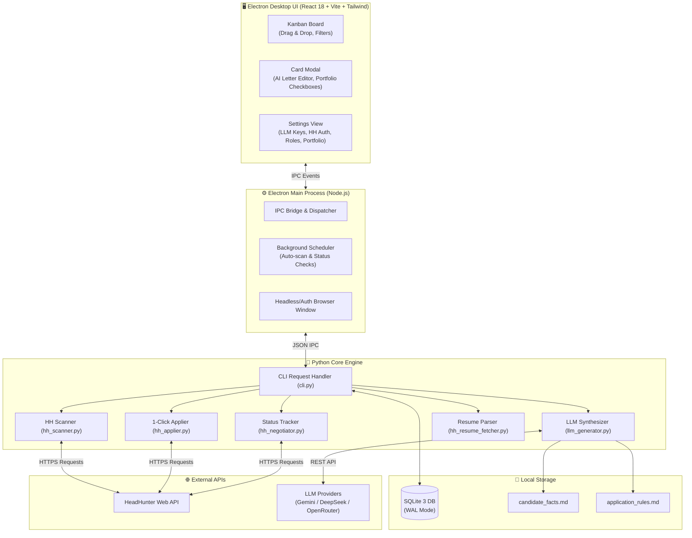

<div align="center">

# 🎯 JobHunter: Autonomous AI Career Assistant

**Профессиональное десктопное приложение для автоматизации поиска работы и точечных откликов на HeadHunter с помощью ИИ**

[](https://www.electronjs.org/)
[](https://react.dev/)
[](https://www.typescriptlang.org/)
[](https://vitejs.dev/)
[](https://www.python.org/)
[](https://www.sqlite.org/)
[](https://tailwindcss.com/)
[](LICENSE)

<br/>

*JobHunter превращает рутинный процесс поиска работы в структурированную, управляемую воронку. Приложение непрерывно мониторит новые вакансии, фильтрует их, генерирует уникальные живые сопроводительные письма под каждую вакансию с помощью LLM (Gemini, DeepSeek, OpenRouter) и отслеживает изменения статусов на HeadHunter в реальном времени.*

</div>

---

## 🌟 Ключевые возможности

### 1. 🔍 Автономный сканер HeadHunter
- Параллельный сбор вакансий по настраиваемым поисковым ролям (Game Design, Narrative, 3D Art, Motion, Management и др.).
- Умная дедупликация: исключение повторных предложений через постоянную базу `seen_vacancies`.
- Фильтрация по минимальной зарплате, графику (удаленная работа) и стоп-словам.
- Безопасная работа с HH: использование актуального User-Agent и перехват сессионных куки через встроенное безопасное окно авторизации (без передачи паролей сторонним серверам).

### 2. 📋 Интерактивная Kanban-доска
- **5 стадий воронки**: 
  - `📥 Найдено (Бэклог)` — свежие вакансии, отобранные сканером.
  - `⭐ Одобрено мной` — вакансии, прошедшие ручной отбор и готовые к отправке.
  - `✉️ Отклик отправлен` — отправленные заявки на рассмотрении работодателем.
  - `💬 Интервью / Созвон` — приглашения на собеседование.
  - `📦 Отказ / Архив` — отклоненные вакансии (с кнопкой очистки и сохранением в базу исключений).
- Быстрый просмотр описания, условий, зарплатной вилки и требований.
- Функция **пакетной отправки** всех одобренных вакансий в 1 клик.

### 3. 🧠 ИИ-генератор живых сопроводительных писем (LLM Engine)
- **Принцип живого автора**: категорический отказ от шаблонных канцелярских фраз (*«Здравствуйте, меня заинтересовала ваша вакансия...»*).
- Генерация от первого лица на базе подтвержденных фактов кандидата ([`candidate_facts.md`](src/engine/candidate_facts.md)) и редполитики ([`application_rules.md`](src/engine/application_rules.md)).
- Поддержка передовых LLM-провайдеров:
  - **Google Gemini** (`gemini-3.6-flash`, `gemini-flash-latest`, `gemini-2.5-pro`) — бесплатно через Google AI Studio.
  - **DeepSeek** (`deepseek-chat V3`, `deepseek-reasoner R1`).
  - **OpenRouter** (бесплатные модели Llama 3.3 70B, Qwen 2.5 72B, DeepSeek R1).
  - **Groq** (высокоскоростной вывод Llama 3.3).
- Кнопка *«Другой вариант»* для мгновенной перегенерации под другим углом подачи.

### 4. 🔄 Авто-трекинг статусов откликов на HeadHunter
- Точечный опрос кабинета откликов через прямой API-эндпоинт (`applicantVacancyResponseStatuses`).
- Автоматически распознает:
  - `DISCARD` (Отказ) ➔ мгновенно переносит карточку в колонку «Отказ / Архив».
  - `INVITATION` (Приглашение) ➔ автоматически перемещает вакансию в «Интервью / Созвон».
- Скорость проверки: ~3 секунды на весь пул откликов без открытия тяжелого браузера.

### 5. 🎨 Гибкое управление материалами портфолио
- Встроенная панель настройки ссылок портфолио с инлайн-редактированием названий, URL и категорий.
- Интерактивные чекбоксы в модальном окне карточки: при выборе материала его название и ссылка аккуратно добавляются в письмо, при снятии — удаляются без дублирования.
- Автоматическая защита от дублирования контактов и ссылок при отправке на HH.

### 6. ⚡ Архитектура и приватность данных
- **100% Offline-First / Local**: все вакансии, логи, настройки и сессии сохраняются в локальную базу данных SQLite на вашем компьютере (`%APPDATA%/job-hunter-app/job_hunter.db`).
- Режим **SQLite WAL** (Write-Ahead Logging) с `busy_timeout = 30000ms` гарантирует защиту от блокировок при одновременных операциях чтения и записи.
- Никакой скрытой телеметрии, аналитики или облачных баз данных.

---

## 🏗️ Архитектура системы



---

## 🛠️ Стек технологий

| Уровень | Технологии |
|---|---|
| **Десктопная оболочка** | [Electron 31](https://www.electronjs.org/), TypeScript, Electron Builder |
| **Фронтенд** | [React 18](https://react.dev/), [Vite 5](https://vitejs.dev/), [Tailwind CSS 3](https://tailwindcss.com/) |
| **Иконки и стиль** | [Lucide React](https://lucide.dev/), Custom Slate/Indigo Dark Theme |
| **Бэкенд / Движок** | [Python 3.10+](https://www.python.org/) (urllib, re, json, threading) |
| **База данных** | [SQLite 3](https://www.sqlite.org/) (WAL Journal Mode, Busy Timeout 30s) |
| **Нейросети (LLM)** | Google Gemini API, DeepSeek API, OpenRouter API, Groq |

---

## 🚀 Быстрый старт (Установка и запуск)

### Требования
- **Node.js** версии 18 или новее (рекомендуется 20 LTS)
- **Python** версии 3.10 или новее
- Операционная система: **Windows 10 / 11**

### 1. Клонирование репозитория
```bash
git clone https://github.com/your-username/job-hunter.git
cd job-hunter
```

### 2. Установка зависимостей
```bash
npm install
```

### 3. Запуск в режиме разработки
```bash
npm run dev
```
*Запустится Vite Dev Server и окно Electron с горячей перезагрузкой (HMR).*

### 4. Сборка исполняемого `.exe` файла
```bash
npm run pack
```
После завершения готовое приложение будет сформировано в папке:
`build/win-unpacked/JobHunter.exe`.

---

## ⚙️ Первоначальная настройка

1. **Авторизация в HeadHunter**:
   - Перейдите во вкладку **«Настройки» ➔ «Поиск и HH»**.
   - Нажмите **«Войти через HeadHunter»**.
   - В открывшемся окне авторизуйтесь на сайте hh.ru. Куки сессии перехватятся автоматически, а ваши резюме сразу подгрузятся в систему.

2. **Подключение ИИ (LLM API)**:
   - Перейдите в **«Настройки» ➔ «Нейросеть (LLM)»**.
   - Выберите провайдера (рекомендуется **Google Gemini** или **DeepSeek**).
   - Вставьте API-ключ (бесплатный ключ Gemini можно получить за 1 минуту на [aistudio.google.com](https://aistudio.google.com/app/apikey)).

3. **Настройка фактов и портфолио**:
   - Во вкладке **«Портфолио»** добавьте ссылки на ваши кейсы, Notion-спеки, ArtStation, GitHub или шоурилы.
   - В файле [`src/engine/candidate_facts.md`](src/engine/candidate_facts.md) заполните реальные факты из вашего опыта — именно на них ИИ опирается при составлении текстов.

4. **Запуск поиска**:
   - Нажмите кнопку **«Сканировать HH»** в шапке приложения. Вакансии начнут поступать в колонку «Найдено».

---

## 📁 Структура проекта

```
JobHunter/
├── assets/                  # Иконки приложения (icon.png, icon.ico)
├── src/
│   ├── main/                # Главный процесс Electron
│   │   ├── main.ts          # Жизненный цикл приложения, окна и IPC-обработчики
│   │   ├── preload.ts       # Безопасный контекстный мост Electron API
│   │   ├── scheduler.ts     # Фоновый планировщик проверок
│   │   ├── tray.ts          # Сворачивание в системный трей
│   │   └── hh_auth_window.ts# Окно авторизации HeadHunter
│   │
│   ├── renderer/            # React SPA интерфейс
│   │   ├── components/
│   │   │   ├── Board/       # Kanban-доска, карточки вакансий, модальное окно
│   │   │   ├── Settings/    # Настройки HH, LLM, стилей, ссылок портфолио
│   │   │   └── LogModal/    # Терминал логов движка в реальном времени
│   │   ├── styles/          # Tailwind и кастомные CSS переменные
│   │   ├── types.ts         # TypeScript интерфейсы вакансий и настроек
│   │   └── App.tsx          # Корневой компонент интерфейса
│   │
│   └── engine/              # Автономный Python-движок
│       ├── cli.py           # CLI диспетчер IPC команд от Electron
│       ├── db.py            # SQLite менеджер (миграции, WAL-режим, настройки)
│       ├── hh_scanner.py    # Парсер вакансий HH
│       ├── hh_negotiator.py # Точечный трекер статусов откликов
│       ├── hh_applier.py    # 1-Click отправка отклика на HeadHunter
│       ├── llm_generator.py # Генератор сопроводительных писем через LLM API
│       ├── candidate_facts.md   # База подтвержденных фактов кандидата
│       └── application_rules.md # Редполитика живой речи для ИИ
│
├── package.json             # Конфигурация проекта и скрипты сборки
├── tsconfig.json            # Настройки TypeScript
├── vite.config.ts           # Конфигурация сборщика Vite
└── tailwind.config.js       # Конфигурация дизайн-системы Tailwind
```

---

## 🔒 Безопасность и конфиденциальность

- **Никаких удаленных серверов**: приложение связывается исключительно с официальными API HeadHunter и выбранного вами LLM-провайдера (Google / DeepSeek / OpenRouter).
- **Хранение секретов**: API-ключи и сессионные куки сохраняются только в локальной БД SQLite в защищенной директории пользователя вашего ПК.
- **Репозиторий готов к публикации**: в исходном коде отсутствуют захардкоженные токены, пароли или приватные ключи.

---

## 📄 Лицензия

Проект распространяется под свободной лицензией [MIT](LICENSE). Вы можете использовать, модифицировать и адаптировать его под любые свои цели.

---

<div align="center">
  <sub>Разработано с душой для эффективного и осознанного поиска работы. Made with ❤️ by Pavel Tejeda.</sub>
</div>
